# 🧭 Roddy (로디) - Backend
> **"나만의 커리어 로드맵을 그려주는 AI 멘토, Roddy"**
> 홍익대학교 컴퓨터공학과 졸업 프로젝트 (2026)

## 📖 1. 프로젝트 소개
**Roddy**는 개발자 지망생 및 주니어 개발자를 위한 **개인 맞춤형 전공/커리어 설계 및 로드맵 가이드 서비스**입니다. 
사용자의 GitHub 리포지토리와 이력서를 분석하여 현재의 기술 스택 수준(Tier)을 진단하고, 실제 채용 공고(Trend)와 합격자 데이터를 바탕으로 부족한 기술과 다음 학습 방향을 'Graph' 형태로 시각화하여 추천해 줍니다.

## 👨‍💻 2. 역할
| 이름 | 역할 | 담당 업무 | GitHub |
| :---: | :---: | :--- | :---: |

## 🏗️ 3. 시스템 아키텍처 (System Architecture)

```mermaid
%% Generated by https://gitdiagram.com/roddy-hongik/roddy_be
flowchart TD

subgraph group_identity["Identity and Profile"]
  node_auth["Accounts and Login<br/>[AuthService.java]"]
  node_profile["Profile and Onboarding"]
  node_github["GitHub Connection"]
end

subgraph group_career["Career Guidance"]
  node_analysis["Skill Analysis"]
  node_ai_analysis["Analysis AI Client"]
  node_roadmap["Career Roadmaps"]
  node_ai_roadmap["Roadmap AI Client"]
  node_interview["Interview Practice"]
  node_ai_interview["Interview AI Client"]
  node_graph["Technology Graph"]
end

subgraph group_jobs["Job Market"]
  node_jobs["Job Search and Matching"]
  node_crawl["Job Collection"]
  node_ingest["Posting Ingestion"]
  node_notifications["Notifications"]
end

subgraph group_engagement["Community and Learning"]
  node_community["Developer Community"]
  node_study["Study Groups<br/>[StudyService.java]"]
  node_coverletter["Cover Letters"]
end

subgraph group_platform["Data and Integrations"]
  node_mysql[("MySQL Data")]
  node_crawler_engine["Crawler Engine"]
end

node_developer(("Developer"))
node_external_jobs(("Employer Job Sites"))
node_external_ai(("AI Services"))
node_external_github(("GitHub"))

node_developer -->|"connects repositories"| node_github
node_developer -->|"requests guidance"| node_analysis
node_github -->|"provides repository data"| node_analysis
node_analysis -.->|"requests analysis"| node_ai_analysis
node_developer -->|"gets career plan"| node_roadmap
node_roadmap -.->|"requests generation"| node_ai_roadmap
node_developer -->|"views recommendations"| node_graph
node_developer -->|"browses opportunities"| node_jobs
node_external_jobs -.->|"serves listings"| node_crawler_engine
node_crawler_engine -.->|"collects postings"| node_crawl
node_ingest -->|"persists postings"| node_mysql
node_ingest -->|"creates match alerts"| node_notifications
node_notifications -->|"reads user tech stack"| node_analysis
node_notifications -->|"calculates match rate"| node_jobs
node_auth -->|"reads and writes users"| node_mysql
node_auth -.->|"supports sign-in"| node_developer
node_developer -.->|"participates"| node_community
node_developer -.->|"joins study groups"| node_study
node_developer -.->|"practices interviews"| node_interview
node_interview -.->|"requests questions"| node_ai_interview
node_developer -.->|"manages applications"| node_coverletter
node_developer -.->|"sets career profile"| node_profile
node_github -->|"uses OAuth"| node_external_github
node_analysis -.->|"stores reports"| node_mysql
node_graph -.->|"stores graph data"| node_mysql
node_roadmap -.->|"stores roadmaps"| node_mysql
node_analysis -.->|"calls AI"| node_external_ai
node_roadmap -.->|"calls AI"| node_external_ai
node_interview -.->|"calls AI"| node_external_ai

click node_auth "https://github.com/roddy-hongik/roddy_be/blob/main/roddy/src/main/java/com/roddy/domain/auth/service/AuthService.java"
click node_profile "https://github.com/roddy-hongik/roddy_be/blob/main/roddy/src/main/java/com/roddy/domain/onboarding/service/OnboardingService.java"
click node_github "https://github.com/roddy-hongik/roddy_be/blob/main/roddy/src/main/java/com/roddy/domain/onboarding/service/GithubOnboardingService.java"
click node_analysis "https://github.com/roddy-hongik/roddy_be/blob/main/roddy/src/main/java/com/roddy/domain/analysis/service/AnalysisService.java"
click node_ai_analysis "https://github.com/roddy-hongik/roddy_be/blob/main/roddy/src/main/java/com/roddy/global/client/analysis/AnalysisAiClient.java"
click node_roadmap "https://github.com/roddy-hongik/roddy_be/blob/main/roddy/src/main/java/com/roddy/domain/roadmap/service/RoadMapService.java"
click node_ai_roadmap "https://github.com/roddy-hongik/roddy_be/blob/main/roddy/src/main/java/com/roddy/global/client/roadmap/RoadMapAiClient.java"
click node_interview "https://github.com/roddy-hongik/roddy_be/blob/main/roddy/src/main/java/com/roddy/domain/interview/service/InterviewService.java"
click node_ai_interview "https://github.com/roddy-hongik/roddy_be/blob/main/roddy/src/main/java/com/roddy/global/client/interview/InterviewAiClient.java"
click node_graph "https://github.com/roddy-hongik/roddy_be/blob/main/roddy/src/main/java/com/roddy/domain/graph/service/TechGraphService.java"
click node_jobs "https://github.com/roddy-hongik/roddy_be/blob/main/roddy/src/main/java/com/roddy/domain/jobposting/service/JobPostingService.java"
click node_crawl "https://github.com/roddy-hongik/roddy_be/blob/main/roddy/src/main/java/com/roddy/domain/jobposting/service/JobPostingCrawlService.java"
click node_ingest "https://github.com/roddy-hongik/roddy_be/blob/main/roddy/src/main/java/com/roddy/domain/jobposting/service/JobPostingIngestService.java"
click node_notifications "https://github.com/roddy-hongik/roddy_be/blob/main/roddy/src/main/java/com/roddy/domain/notification/NotificationService.java"
click node_community "https://github.com/roddy-hongik/roddy_be/blob/main/roddy/src/main/java/com/roddy/domain/community/service/CommunityPostService.java"
click node_study "https://github.com/roddy-hongik/roddy_be/blob/main/roddy/src/main/java/com/roddy/domain/study/service/StudyService.java"
click node_coverletter "https://github.com/roddy-hongik/roddy_be/blob/main/roddy/src/main/java/com/roddy/domain/coverletter/service/CoverLetterService.java"
click node_mysql "https://github.com/roddy-hongik/roddy_be/blob/main/roddy/src/main/java/com/roddy/domain/auth/repository/UserRepository.java"
click node_crawler_engine "https://github.com/roddy-hongik/roddy_be/blob/main/roddy/src/main/java/com/roddy/global/crawler/engine/DeclarativeCrawler.java"

classDef toneNeutral fill:#f8fafc,stroke:#334155,stroke-width:1.5px,color:#0f172a
classDef toneBlue fill:#dbeafe,stroke:#2563eb,stroke-width:1.5px,color:#172554
classDef toneAmber fill:#fef3c7,stroke:#d97706,stroke-width:1.5px,color:#78350f
classDef toneMint fill:#dcfce7,stroke:#16a34a,stroke-width:1.5px,color:#14532d
classDef toneRose fill:#ffe4e6,stroke:#e11d48,stroke-width:1.5px,color:#881337
classDef toneIndigo fill:#e0e7ff,stroke:#4f46e5,stroke-width:1.5px,color:#312e81
classDef toneTeal fill:#ccfbf1,stroke:#0f766e,stroke-width:1.5px,color:#134e4a
class node_auth,node_profile,node_github toneBlue
class node_analysis,node_ai_analysis,node_roadmap,node_ai_roadmap,node_interview,node_ai_interview,node_graph toneAmber
class node_jobs,node_crawl,node_ingest,node_notifications toneMint
class node_community,node_study,node_coverletter toneRose
class node_mysql,node_crawler_engine,node_developer,node_external_jobs,node_external_ai,node_external_github toneIndigo
```

## 🚀 4. 백엔드 핵심 기술 및 챌린지 (Technical Highlights)

## 🗄️ 5. 데이터베이스 ERD

## ⚙️ 6. 실행 방법 (Getting Started)

### Prerequisites
* Java 17
* MySQL 8.0+
* Redis (Local or Docker)
